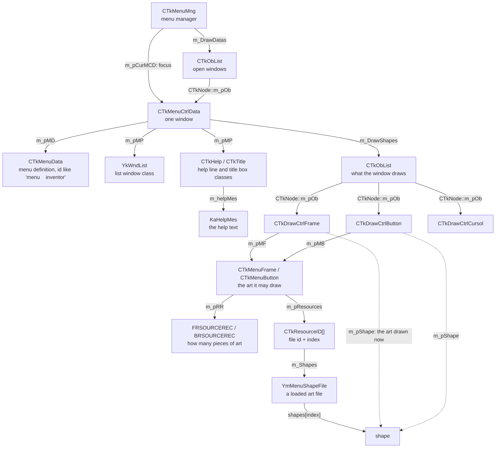

# Ashita4-MenuManager

A small library for Ashita v4 plugins that reads Final Fantasy XI's menu windows.

FFXI keeps its open menus (inventory, equipment, the main menu, shops) in a menu manager inside `FFXiMain.dll`. This
library finds it and wraps it in an interface like the Ashita SDK's managers.

With it you can:

- list the open windows and find the focused one
- read a window's position, cursor, buttons and scroll state
- see what a window draws, down to the art file
- read the help line
- move the cursor and send keys, after checking they'll reach the right window
- hide a window's own drawing so you can draw your own in its place (optional, see below)

## Example

```cpp
#include <menumanager/menu_manager.h>
#include <psapi.h>

std::unique_ptr<menumanager::IMenuManager> menus;

bool MyPlugin::Initialize(IAshitaCore* core, ILogManager* log, uint32_t id)
{
    MODULEINFO module{};
    GetModuleInformation(GetCurrentProcess(), GetModuleHandleA("FFXiMain.dll"), &module, sizeof(module));

    const char* missing = nullptr;
    menus = menumanager::createMenuManager(reinterpret_cast<uintptr_t>(module.lpBaseOfDll), module.SizeOfImage, &missing);
    if (!menus)
    {
        log->Logf(1, "myplugin", "menu manager not found (%s)", missing);
    }

    return menus != nullptr;
}

void MyPlugin::Direct3DPresent(...)
{
    menumanager::FFXI::menuwindow_t window{};
    if (const auto focused = menus->GetCurrentWindow(); focused != 0 && menus->GetWindowInfo(focused, &window))
    {
        // window.Name is the menu id ("inventor", "equip", "menuwind"), window.Cursor the selected button
    }
}
```

## API

A window is the address of the game's `CTkMenuCtrlData` object.

| Call | Returns |
|---|---|
| `GetMenuRect` | The menu area |
| `GetWindows` | Every open window |
| `GetCurrentWindow` | The focused window, or 0 |
| `IsWindowAlive` | Whether a window is still open |
| `GetWindowInfo` | Name, position, cursor, button count, status, priority, opening and fade animation |
| `GetWindowList` | Scroll state of a list window: rows per page, first visible row, item count, row height |
| `GetWindowObjects` | The window's frames, buttons and cursor, and optionally the art each frame and button draws |
| `GetWindowHelp` | The text of the help line or the title box, in UTF-8, and whether an indicator is drawn instead |
| `CanPress` | Whether a key sent now reaches this window and the button is one of its own |
| `CanCancel` | Whether Cancel can be sent for this window |
| `SetWindowCursor` | Moves a window's cursor to a button |
| `PressKey` | Sends Ok, Cancel, Left or Right to the focused window |

Some helpers sit outside the interface:

| Header | |
|---|---|
| `menumanager/window_state.h` | `isAnimating` tells whether a window is opening or closing, `opacity` how faded its frame is |
| `menumanager/window_watcher.h` | `WindowWatcher` lists the windows that opened and closed since its last update |
| `menumanager/slider_driver.h` | `SliderDriver` moves a config slider to a value with the same keys a player would press |
| `menumanager/text.h` | `decodeText` turns the game's Shift-JIS text and control codes into UTF-8 |

A few things to know:

- Button numbers are per page (1 to 10 on a list). To get the item, add the first visible row from `GetWindowList`.
- `GetWindowObjects` sets `complete` when the whole list was read and didn't change while it was read. If it's false,
  the result may be missing objects.
- There's no text apart from the help line and the title box. Each window class draws its own strings, so for any
  other window you need a draw hook.
- `GetWindowHelp` only works for `helpwind` and `titlewin`, and only if their draw functions were found. While the
  title box shows the POL handle it returns false. When `Busy` isn't `None`, the line shows the loading indicator
  (`Loading`) or the auction or another animation (`Other`), and `Text` is empty. Text that doesn't fit in 255 bytes is cut at a character boundary.
- A key goes to whichever window has focus, and an Ok can open or close a window at once. Call `CanPress` before
  every key, not once for a batch. `CanCancel` allows a focused child window, since that is what
  Cancel closes.
- `SliderDriver` reads the slider's fill back every frame and steers by it. Which of Left and Right raises a slider
  hasn't been confirmed on PC (the PS2 version raises on Right), so it starts with Right and switches if the bar goes
  the wrong way. `SliderStep::apply` checks `CanPress` before each input and stops early if it fails.
- The game's structures are in `menumanager/raw/`, one header per class, named as in the PS2 version's debug symbols.
  `raw/memory.h` has reads that fail safely on bad pointers and `raw/walk.h` walks the game's linked lists.

## Hiding a window's own drawing

The `menumanager::suppress` target can stop the game drawing chosen windows, so a plugin can draw its own version in
their place. It is a separate library because it hooks `CTkMenuCtrlData::OnDraw` with
[MinHook](https://github.com/TsudaKageyu/minhook). The base library never patches the game.

A hidden window still runs its logic. Only its Direct3D draws are dropped. Your plugin forwards its Direct3D callbacks
to the `WindowSuppressor`, and Ashita drops a draw when the callback returns true. A `DrawListener` decides which
windows to hide. The suppressor calls it before and after each window draws and shows it every draw the window makes,
so it can also read what a window drew.

```cpp
#include <menumanager/suppress/window_suppressor.h>

class HideInventory final : public menumanager::DrawListener
{
public:
    menumanager::IMenuManager* menus{};

    auto beginWindow(uintptr_t window) -> bool override
    {
        menumanager::FFXI::menuwindow_t info{};
        return menus->GetWindowInfo(window, &info) && std::string_view(info.Name) == "inventor";
    }
};

std::unique_ptr<menumanager::WindowSuppressor> suppressor;
HideInventory                                  listener;

// in Initialize, after createMenuManager
suppressor = menumanager::createWindowSuppressor(base, size, &missing);
listener.menus = menus.get();
suppressor->setListener(&listener);

// device is the IDirect3DDevice8* Ashita passes to your plugin
bool MyPlugin::Direct3DDrawPrimitive(D3DPRIMITIVETYPE type, UINT, UINT count)
{
    return suppressor->onDrawPrimitive(device, type, count);
}

bool MyPlugin::Direct3DDrawIndexedPrimitive(D3DPRIMITIVETYPE type, UINT, UINT, UINT, UINT count)
{
    return suppressor->onDrawPrimitive(device, type, count);
}

bool MyPlugin::Direct3DDrawPrimitiveUP(D3DPRIMITIVETYPE type, UINT count, const void* data, UINT stride)
{
    return suppressor->onDrawPrimitiveUP(device, type, count, data, stride);
}

bool MyPlugin::Direct3DDrawIndexedPrimitiveUP(D3DPRIMITIVETYPE type, UINT minIndex, UINT vertices, UINT count, const void*, D3DFORMAT, const void* data, UINT stride)
{
    return suppressor->onDrawIndexedPrimitiveUP(device, type, minIndex, vertices, count, data, stride);
}
```

Some things drawn during a window's draw aren't part of the window, such as the target arrow. So a hidden window's
`DrawPrimitiveUP` draws that land more than 48 pixels outside its rect still go through. `setKeepOutsideDraws(false)`
turns that off.

Only one suppressor can hold the hook. Destroying it removes the hook. If `unhook` returns false, another plugin has
hooked over it and the hook stays in place, passing every draw through to the game. Your module then has to stay loaded.
If your plugin finds `OnDraw` itself, for example to report another plugin's hook on it, `kWindowDrawPattern` is the
pattern and `attachWindowSuppressor` takes the address.

```cmake
target_link_libraries(myplugin PRIVATE menumanager::menumanager menumanager::suppress)
```

## How the game stores its menus

Each arrow is a field this library follows.



The dotted arrows point at the art on screen right now. To find out which file and index it is, the library looks for
the same shape among the art the frame or button declares.

## Files

| Path | |
|---|---|
| `include/menumanager/menu_manager.h` | `IMenuManager` and the functions that create it |
| `include/menumanager/ffxi/` | The types the calls return |
| `include/menumanager/raw/` | The game's structures |
| `include/menumanager/*.h` | The helpers: window state, the watcher, the slider driver and text decoding |
| `src/` | One file per call, the helpers, the art lookup, and the safe memory read |
| `include/menumanager/suppress/`, `src/suppress/` | The `menumanager::suppress` target |
| `tests/` | Unit tests against a fake window built in memory |

## Building

You need the Ashita v4 SDK and an x86 MSVC toolchain. Point `ASHITA4_SDK_PATH` at `<Ashita>\plugins\sdk`, then:

```text
cmake -S . -B build -G Ninja -DCMAKE_BUILD_TYPE=Release
cmake --build build
build\menumanager_tests.exe
```

To use it in your plugin, add it with CPM or `add_subdirectory` and link `menumanager::menumanager`. Its tests only
build when it's the top-level project, or with `-DMENUMANAGER_TESTS=ON`.

```cmake
CPMAddPackage(NAME Ashita4-MenuManager GITHUB_REPOSITORY sruon/Ashita4-MenuManager GIT_TAG main)
target_link_libraries(myplugin PRIVATE menumanager::menumanager)
```

## Client updates

The library finds the game's functions by byte pattern, so a client update can break them. `createMenuManager` then
returns null and names the pattern it couldn't find. The help line and title box draws are the exception: without them
you still get a manager, `GetWindowHelp` returns false for that window, and `missing` names the draw.

[xirml](https://github.com/sruon/xirml) uses this library on the current retail client.

## Licence

MIT, see [LICENSE](LICENSE).
